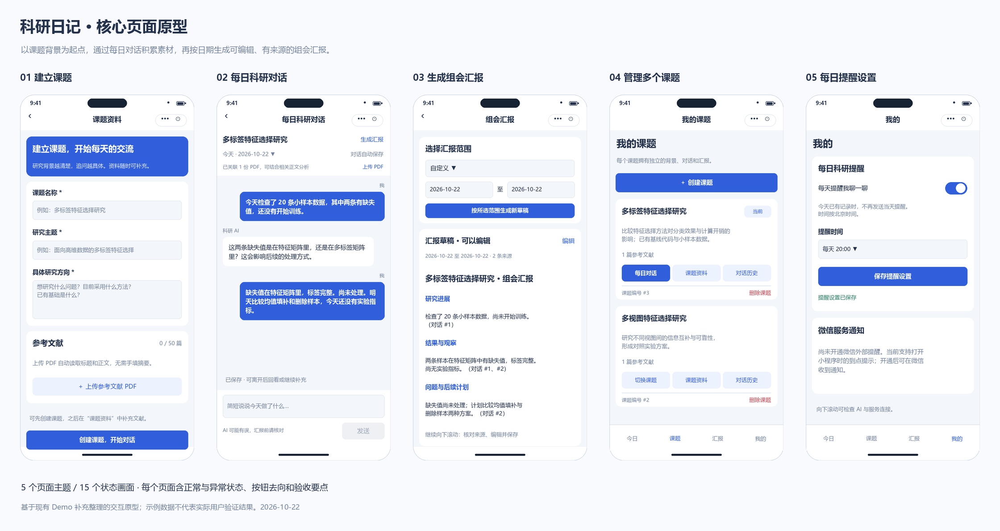
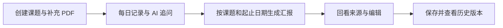

# 科研日记 Research Journal

**基于课题背景的每日 AI 对话与组会汇报微信小程序。**

建立课题、上传参考文献，每天用几句话记录研究进展；AI 结合背景追问，再按日期整理成可追溯来源、可编辑的组会汇报草稿。

这是一个 AI 产品经理个人实践项目。我负责需求取舍、产品文档、原型核对与人工验收，借助 Codex 协作实现前后端。实际过程包含设计问卷、PRD、原型与测试方案，并根据测试反馈迭代。

[作品集 PDF](docs/portfolio/科研日记_AI产品经理作品集.pdf) · [产品设计材料](docs/product/README.md) · [AI 技术方案](docs/architecture.md) · [测试与已知问题](docs/testing/README.md) · [本地运行](docs/quickstart.md)



*图为基于 Demo 整理的交互原型，包含合成示例数据；当前实现和原型的个别细节以代码与测试记录为准。*

## 产品解决什么问题

面向需要定期向导师或课题组汇报的科研参与者，关注一个待验证的问题：研究记录分散、日常记录不持续，组会前需要回忆过程、回找材料和组织内容。

| 产品决策 | 具体实现 |
| --- | --- |
| 降低日常记录门槛 | 从“今天做了什么”的一句话开始，由 AI 追问需要补充的事实 |
| 用课题背景约束追问 | 输入主题、方向、同课题历史和相关 PDF 片段 |
| 区分背景知识与实际成果 | 文献用于对话背景；汇报只采用指定日期内的用户发言 |
| 让用户能核对和修改 | 汇报显示原始对话来源，支持编辑、复制及版本保存 |

## 已实现的核心流程



- **课题资料**：名称、主题、具体方向、PDF 参考文献；多课题切换与删除确认。
- **每日对话**：按天自动保存，支持补记；模型失败后保留发言，幂等重试补回复。
- **PDF 文献分析**：按页提取文字、分块及关键词检索，为 AI 提供带页码的相关片段。
- **组会汇报**：筛选业务日期；只依据期间用户发言；异常引用拒绝并回退为原始记录。
- **每日提醒**：默认北京时间 20:00，可修改或关闭；今日已记录则不再提示。

## AI 能力如何实现

| 能力 | 当前实现 |
| --- | --- |
| Prompt Engineering | 课题与历史上下文、日期约束、最多两个追问、禁止虚构研究结果 |
| RAG | pypdf 提取与按页分块，使用关键词和标题匹配排序；未接入向量检索或重排序模型 |
| Workflow | 后端编排日期过滤、模型 JSON 输出、source_ids 校验、降级、人工编辑与保存 |
| Function Calling | 当前每日对话主链路未实现模型自主工具调用 |

技术栈：**uni-app / Vue 3 + FastAPI / Python + SQLite + 兼容 OpenAI 的模型 API**。本地已连接过 DeepSeek；公开模板默认 mock 模式，不携带 API 密钥。LangGraph 保留在旧版计划、风险与汇报接口中，当前每日对话主流程由后端业务逻辑编排。

## 验证状态

功能人工验收表共 36 条：**31 通过、2 失败、2 阻塞、1 不适用**，依据 2026-11-19 材料快照。F28 另有 5 项接口防护检查通过，不能替代阻塞的页面验收或语义一致性评估。

AI 评估方案已设计 **20 场景 × 3 轮**，尚未执行完整评分。问卷已设计 13 题，未发放；没有真实用户样本、线上留存或提效比例。

仓库包含可运行的自动测试与 GitHub Actions 配置；Actions 的实际结果以仓库发布后显示为准。详见[测试说明](docs/testing/README.md)。

## 快速开始

先阅读[完整启动指南](docs/quickstart.md)。需要 Python、Node.js 和微信开发者工具。

```powershell
cd backend
python -m venv .venv
.\.venv\Scripts\python.exe -m pip install -r requirements.txt
Copy-Item .env.example .env
.\.venv\Scripts\python.exe -m uvicorn app.main:app --host 127.0.0.1 --port 8000
```

另开一个终端构建前端：

```powershell
cd frontend
npm ci
npm run build:preview
```

在微信开发者工具中导入 `frontend/dist/dev/mp-weixin`。无模型密钥时可体验基础追问、保存与原文汇报；要体验模型追问与归纳，请在自己的 `backend/.env` 配置模型并重启后端。

## 展示范围

当前为本地单用户 Demo。微信外部订阅通知尚未配置与验证，默认展示站内提醒；扫描 PDF 无 OCR；上线服务需要补充登录鉴权、用户隔离、正式 HTTPS 与运维配置。GitHub 仓库用于代码与作品材料展示，本身不提供运行中的后端。

公开副本不包含真实 `.env`、数据库、上传论文、聊天历史、依赖目录、构建产物和本地日志。
