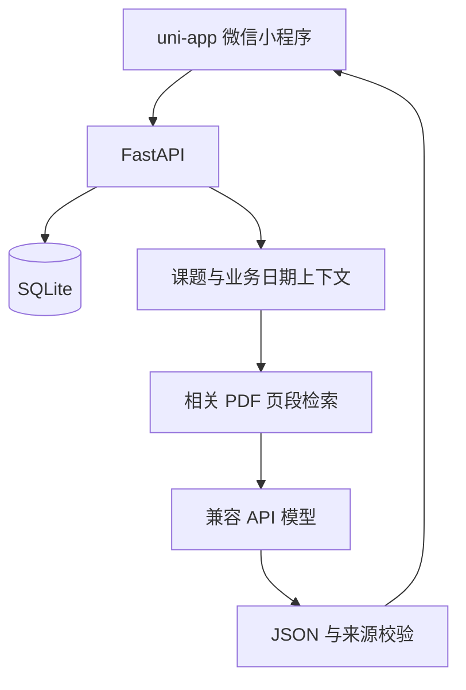

# AI 与系统实现

## 当前主链路

## 对话与消息恢复

`backend/app/journal_service.py` 先保存用户发言，然后取同课题、业务日期不晚于当前记录日的最近 20 轮历史。历史项附记录日期和与当前日期相差的天数。`backend/prompts/daily_dialogue.txt` 约束追问与时间表达。

记录状态区分 pending、failed、complete；`client_token` 保证同一提交的重试补回复，而不重复新增用户消息。模型配置位于后端 `.env`，前端只访问后端。

## PDF 与轻量 RAG

`pdf_extract.py` 使用 pypdf 按页提取可读文字。`reference_service.py` 约按 1600 字符分块、200 字符重叠，再按标题、问题关键词等规则排序。每轮提供有限的相关片段与页码，正文总预算 18000 字符，最多选取六份文献。

这是基于关键词的检索增强生成，当前没有 Embedding、向量数据库或专门的重排序模型。文字提取不等同于理解论文所有图片、公式或表格，也不包含 OCR。

## 日期汇报 Workflow

1. 后端按当前课题和起止日期（含两端）筛选用户发言。
2. 模型按五个章节返回 JSON，每条结论携带 `source_ids`。
3. 后端检查编号必须存在于所选记录中；异常时拒绝 AI 草稿并展示用户原文，明确标注尚未 AI 归纳。
4. 用户查看来源、编辑，保存当前文本为版本。

AI 的历史回复、论文成果和建议不作为用户已完成成果的证据。编号有效不证明语义支持，语义一致性仍需单独评估。

## 代码入口

| 位置 | 职责 |
| --- | --- |
| `backend/app/journal_api.py` | 课题、日对话、汇报等 v2 接口 |
| `backend/app/journal_service.py` | 上下文、日期过滤、消息幂等、汇报来源检查 |
| `backend/app/reference_service.py` | PDF 归属、相关页段选择 |
| `backend/app/pdf_extract.py` | 隔离解析与提取限制 |
| `backend/app/reminder_service.py` | 站内提醒与可选微信通知能力 |
| `backend/prompts/` | 对话与汇报提示词；另保留旧版提示词 |
| `frontend/src/pages/` | 课题、对话、汇报、设置等页面 |

旧版 LangGraph 的计划与风险流程仍用于历史兼容；不将其描述为当前日对话的 Agent 自主工具调用。
