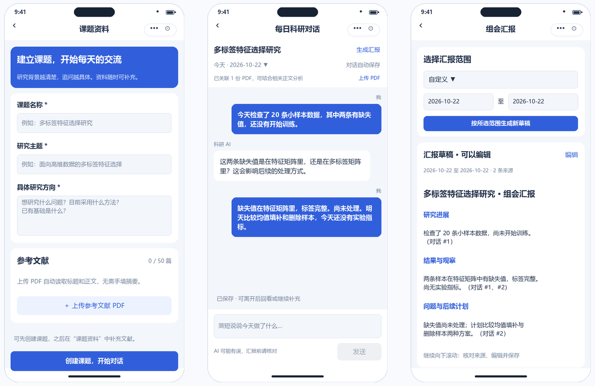
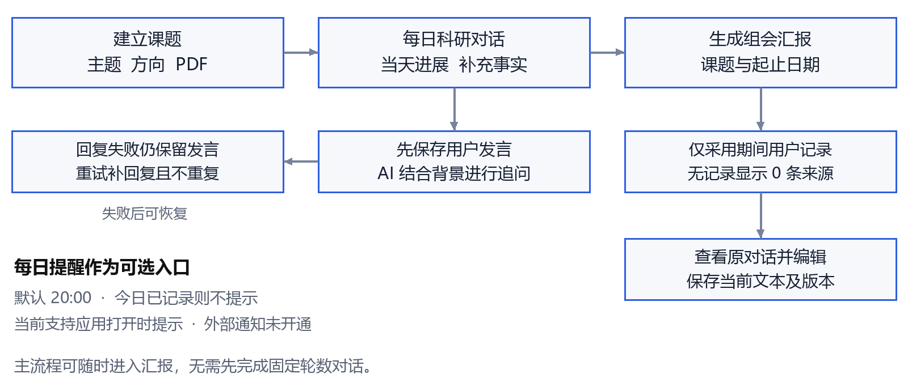
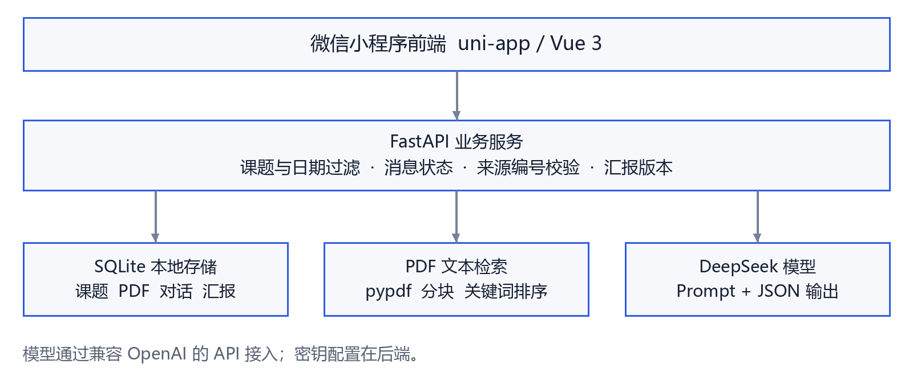

# 科研日记 AI 产品经理作品集

# 科研日记

基于课题背景的每日 AI 对话与组会汇报

AI 产品经理作品集    |    个人项目    |    2026 年 10 月至 11 月

我围绕“日常科研进展难以持续记录，组会前需要回找和整理材料”的场景，设计并实现微信小程序 Demo：用户建立课题、上传参考文献，每天通过简短对话补充进展，再按日期生成可核对来源、可编辑的组会汇报。该问题目前属于待验证的需求假设。

交互原型节选：课题资料、每日科研对话、组会汇报。示例数据用于说明交互，不代表真实用户实验结果。

### 我的职责

我负责明确场景与范围、梳理核心流程、设计问卷和 PRD、核对原型、制定用例并人工验收；借助 Codex 协作完成前后端实现、接口检查及缺陷定位。项目为个人实践。

### 当前交付

已具备本地可演示的记录到汇报闭环，以及问卷、PRD、流程图、5 个页面主题的原型和测试记录。人工验收表记录 31 条通过，仍有失败和阻塞项；系统性 AI 评估尚未执行。项目未上线，未收集真实用户效果数据。

---

## 产品定位与范围取舍

目标用户是需要定期向导师或课题组汇报进展的科研参与者。核心任务是保留研究过程中的事实、观察和计划，并在组会前找回有依据的材料。

### 为什么从任务计划转向每日对话

| 决策 | 实现方式 | 取舍依据 |
| --- | --- | --- |
| 降低开始记录的负担 | 用一句当天进展开始，AI 再追问细节 | 最初的计划与进度表流程较重，后来按实际需求调整为对话入口。 |
| 先建立课题背景 | 主题、方向为必填；文献允许后补 | 让追问围绕当前研究，同时避免上传材料阻断建档。 |
| 让汇报可核对 | 按课题和日期过滤，仅用用户发言作为成果证据 | AI 建议与论文结论可能有启发，但不能自动等同于用户完成的工作。 |
| 保留用户最终决定 | 支持看来源、编辑、复制和保存版本 | AI 先整理草稿，由用户核对事实与措辞。 |

### 调研问卷设计

已设计 13 题、预计 3 至 5 分钟的简短问卷。问题先询问最近的实际行为，再了解功能偏好；包含无课题用户退出和无近期汇报经历的跳转。当前未发放问卷，也未开展访谈，不能据此给出用户比例或提效结论。

| 问题范围 | 要了解什么 | 对产品决策的用途 |
| --- | --- | --- |
| Q1–Q7 | 课题数量、汇报频次、准备耗时、记录习惯与困难 | 判断主要问题出在持续记录、回找材料还是组织内容。 |
| Q8–Q11 | 记录方式、提醒偏好、第三方 AI 数据接受度、功能优先级 | 调整追问长度、提醒方式、隐私说明与范围排序。 |
| Q12–Q13 | 试用意愿与最希望解决的一个问题 | 作为未来研究招募与开放问题线索；本轮不开展招募。 |

### 需求落地与文档版本

PRD 明确创建课题、每日对话、提醒、日期汇报和多课题隔离，并把规则映射为功能用例。实际推进顺序是先完成 Demo，再补齐调研设计、PRD、原型与测试材料，随后根据测试反馈迭代。

附件 PRD V1.0 是 10 月 20 日版本快照。10 月 21 日新增的 PDF 上传、文字提取和按页检索规则单列为能力补充说明；当前方案应结合两份材料阅读。

---

## 核心流程与交互规则

核心流程摘要。完整条件分支、正常与异常页面见附件中的流程图及可编辑原型。

### 设计到验收的对应关系

| 场景 | 关键交互与规则 | 用例 |
| --- | --- | --- |
| 课题与文献 | 创建后进入当前课题；无文献仍能开始。上传可读 PDF 后展示标题和页数；不支持选择文件时给出提示。 | F01–F10 |
| 对话与提醒 | 自动保存发言和回复；可以补记历史日期。每日默认 20:00 提醒，可修改或关闭；今日已记录则不再提示。 | F11–F19 |
| 汇报与来源 | 日期两端均纳入；不同课题相互隔离；空范围显示 0 条来源；用户编辑后的文本按版本保存。 | F20–F30 |
| 删除与恢复 | 删除前说明影响，取消不删除；断网保留输入，恢复后重试；重启后可回看已保存内容。 | F31–F36 |

### 区分两类依据

参考文献用于帮助 AI 理解研究背景和提出问题；用户发言用于说明这段时间实际做了什么。生成组会汇报时，后端只把当前课题、所选期间的用户发言交给模型，防止把文献成果、AI 建议或未来计划当成已完成成果。

### 提醒的当前边界

本地 Demo 支持小程序打开时的到点提示，保留开关与时间设置。微信外部订阅通知尚缺少账号与模板配置，未验证应用关闭后的通知送达，页面明确展示“未开通”。

---

## AI 能力与技术方案

当前每日对话与日期汇报的实现结构。后端控制数据范围和保存规则，模型承担追问与内容归纳。

| 能力 | 已经实现 | 当前边界 |
| --- | --- | --- |
| Prompt 与上下文 | 输入课题主题、方向、最近 20 轮历史及相关文献片段；补充记录日期与相隔天数，要求简短追问、最多 2 个问题。 | 规则需要内容评估验证；单次示例不能证明所有场景稳定。 |
| 轻量 RAG | pypdf 按页提取正文，约 1600 字符分块、200 字符重叠；按问题关键词及标题匹配排序，给模型提供带页码片段。 | 当前为关键词检索，未接入 Embedding、向量数据库或专门的重排序模型；无 OCR。 |
| 汇报 Workflow | 日期和课题过滤 → 模型返回含 source_ids 的 JSON → 后端校验 → 展示来源 → 人工编辑保存。 | 这是后端编排流程；主链路未使用模型自主 Function Calling。 |
| 可靠性与留存 | 先保存用户发言；模型失败保留记录；使用 client_token 识别重试，补上回复而不重复写入。 | 能恢复调用不等于内容一定正确，用户仍需核对 AI 输出。 |

### 把生成风险转为产品规则

汇报中的来源编号必须属于当前课题与日期范围。出现不存在、跨课题或范围外编号时，后端拒绝该 AI 汇报，回退展示原始用户记录，并说明尚未进行 AI 归纳。编号合法只证明记录存在，结论是否被原文支持仍需语义核对。

PDF 单份限制为 10 MiB、80 页；每个课题最多 50 篇。原文存于本机，聊天时仅发送选中的相关片段至模型服务；当前未承诺图片、复杂图表或公式的完整理解。

---

## 功能验收与缺陷迭代

围绕资料、PDF、对话、提醒、汇报、多课题和恢复流程设计 36 条功能用例。下表按现存人工验收表统计；本次整理作品集未重新执行测试。

| 状态 | 数量 | 记录与解释 |
| --- | --- | --- |
| 通过 | 31 | 人工表中标记通过，包含核心记录到汇报闭环、消息重试、删除和重启回看。 |
| 失败 | 2 | F04 文献或笔记编辑的保存边界不一致；F08 加密 PDF 的错误提示不准确。 |
| 阻塞 | 2 | F16 微信外部通知缺少配置；F28 人工页面验收未完成，另有接口检查证据。 |
| 不适用 | 1 | F34 当前交互中，汇报生成时操作被禁用，表中记录为不适用。 |

### 已完成的定位与修复示例

| 观察到的问题 | 定位与处理 | 验证范围 |
| --- | --- | --- |
| 跨日期记录被说成“昨天” | 历史上下文原先容易按上一轮推断时间；补入业务日期和相隔天数，并要求依据日期表达。 | 已做针对性回归；后续仍需覆盖更多补记与跨日语义场景。 |
| AI 中文回复出现乱码 | 定位到 Windows 请求链路的响应解码；改为按原始字节以 UTF-8 解码，并处理 BOM。 | 已做编码回归及一次真实模型中文连通检查；不代表完整 AI 质量评估。 |

### 异常引用的补充证据

11 月 18 日采用临时数据库和受控模型返回，对不存在编号、跨课题编号、范围外编号、混合合法与非法编号及既有回归共 5 项接口检查，均通过。恢复合法输出后可再次生成、保存及回看。该结果验证后端防护，未替代 F28 的页面人工验收，也未证明引用语义正确。

### 保留缺陷状态

本次按当前状态形成求职展示版本。F04、F08 保留为失败，阻塞项说明原因；不将该 Demo 描述为生产环境已验收或全部测试通过。

证据：附件《功能与评价测试记录.xlsx》；《F28接口防护测试记录.md》。

---

## 交付材料与后续验证

### 现有材料索引

| 材料 | 附件位置 | 用途与状态 |
| --- | --- | --- |
| 需求调查问卷 | 01_用户需求调查问卷.docx | 13 题，已设计，未发放。 |
| 产品需求文档 | 02_PRD_V1.0.docx 03_PDF文献能力补充.md | 历史 PRD 与后续文献能力补充配套阅读。 |
| 核心用户流程 | 04_核心用户流程图.drawio 05_核心用户流程图.png | 可编辑文件与完整预览。 |
| 页面原型 | 06_页面原型与交互说明.drawio 07_核心页面总览.png | 5 个页面主题、15 个状态画面；已人工核对。 |
| 测试与防护记录 | 08_功能与评价测试记录.xlsx 09_F28接口防护测试记录.md | 保留人工状态与 AI 评估空表；另附接口检查结果。 |

### 已设计但尚未执行的 AI 评估

评价表包含 20 个固定场景，每场景计划执行 3 轮，共 60 次。当前未填实际完整回复与评分，本作品集不报告 AI 准确率、稳定性或引用正确率。后续可从以下维度检验，而不把功能通过等同于模型质量通过。

| 评价维度 | 判定依据 |
| --- | --- |
| 事实与时间 | 是否虚构训练、指标或完成事项，是否混淆记录日期与计划。 |
| 关联与任务完成 | 追问是否结合课题和已答信息；汇报是否覆盖所选期间的关键记录。 |
| 表达与引用 | 追问是否简短且不超过 2 个问题；每条结论是否被标注来源支持。 |

### 本地演示路径

使用公开或合成资料创建课题 → 上传可读 PDF → 输入两轮进展并返回验证保存 → 选择日期生成汇报 → 查看来源、修改一处内容并保存回看。演示时说明提醒为站内提示，未配置微信外部通知。

### 下一阶段的决策依据

若继续迭代，先修复保存一致性和错误提示，再完成 AI 内容评估。只有在评估发现关键词检索漏检或同义表达召回不足时，才据此比较向量检索、混合检索和重排序的收益与成本。当前项目成果集中在产品设计、可运行闭环和可追溯验收。
